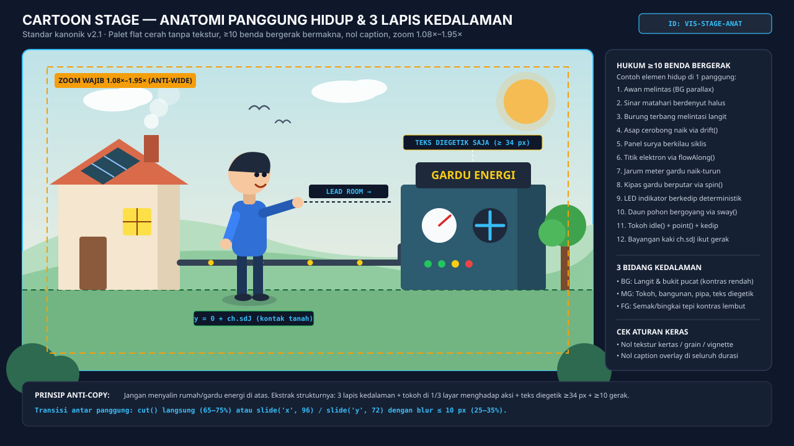
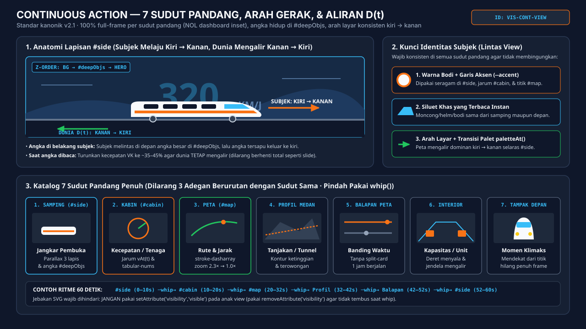
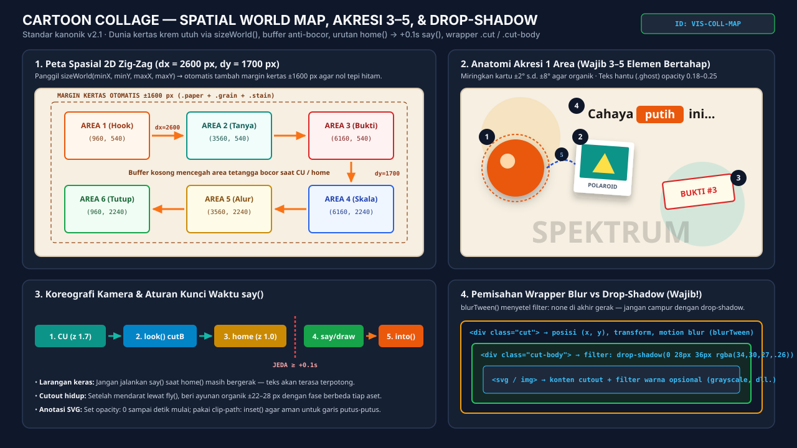

<div align="center">


# Bang Motion

**Agent skill modular untuk membuat video explainer motion graphic di browser — bergerak seperti video, bukan slide.**<br>
Berfokus pada tiga gaya explainer deterministik dalam satu berkas HTML mandiri: **Cartoon Stage**, **Continuous Action**, dan **Cartoon Collage**.

[](#struktur-agent-skill)
[](LICENSE)
[](#cara-menggunakan-agent-skill)

</div>

---

## Tiga Gaya Explainer

<table>
<tr>
<td width="33.3%" valign="top">
<br>
<b>Cartoon Stage</b> (Kartun Panggung)<br>
<sub>Satu panggung vektor hidup per adegan (≥10 benda bergerak), rig sendi aditif <code>J()</code>, kamera zoom logaritmik 1,08–1,95×, nol caption, palet flat cerah.</sub>
</td>
<td width="33.3%" valign="top">
<br>
<b>Continuous Action</b> (Aksi Kontinu)<br>
<sub>Satu subjek dari awal sampai akhir, dunia parallax mengalir <code>D(t)</code>, angka di <code>#deepObjs</code>, 7 sudut pandang full-frame via <code>whip()</code> (nol dashboard inset).</sub>
</td>
<td width="33.3%" valign="top">
<br>
<b>Cartoon Collage</b> (Kartun Kolase)<br>
<sub>Kertas krem dinamis <code>sizeWorld()</code>, akresi 3–5 elemen, wrapper <code>.cut</code> vs <code>.cut-body</code> drop-shadow, pill warna, dan koreografi kamera <code>CU → look → home → say → into</code>.</sub>
</td>
</tr>
</table>

Setiap hasil kerja yang dibuat agen adalah satu berkas HTML mandiri: klik dua kali di browser untuk memutar (autoplay + loop tanpa player di layar), dan tambahkan `?debug=1` untuk membuka **QC HUD bawaan** (scrub deterministik, indikator zoom/view, overlay safe area 9:16, dan tombol **Audit**).

## Cara Menggunakan Agent Skill

Proyek ini adalah **Agent Skill murni** (bukan aplikasi web dan tidak membutuhkan server lokal) dengan **4 folder inti fungsional** (`references/`, `examples/`, `templates/`, `assets/`). Arahkan AI coding agent untuk memulai dari `SKILL.md`:

1. **Selalu dibaca:** `SKILL.md`, `references/explainer-core.md`, `references/anti-ppt.md`, dan `references/reference-index.md` (untuk pemuatan selektif maks. 4 berkas tambahan per fase).
2. **Perencanaan & Konsistensi:** `templates/production-brief.md` + `references/asset-consistency.md` + 1 studi kasus `examples/case-*.md` sesuai gaya.
3. **Muat tepat satu modul gaya, diagram visual SVG-nya, & starternya:**
   - **Cartoon Stage** → `references/cartoon-stage.md` + `references/visuals/stage-*.svg` + `assets/starter-cartoon-stage.html`
   - **Continuous Action** → `references/continuous-action.md` + `references/visuals/continuous-viewpoints-continuity.svg` + `assets/starter-continuous-action.html`
   - **Cartoon Collage** → `references/cartoon-collage.md` + `references/visuals/collage-spatial-blueprints.svg` + `assets/starter-cartoon-collage.html`
4. **Audit Dua Lapis Sebelum Serah:** `templates/qc-audit-scorecard.md` + `examples/good-vs-bad.md` (`F-01..F-07`) + `examples/before-after.md`.

> **Catatan Preview Sementara:** File `index.html` di root hanya berfungsi sebagai alat visualisasi sementara untuk meninjau ketiga starter & 8 lembar referensi SVG secara cepat di browser dan **bukan** bagian inti dari Agent Skill.

## Struktur Agent Skill

```text
SKILL.md                                   Router utama, alur Langkah 0–6, & protokol retrieval (v2.1.0)
references/                                [BACA] Pengetahuan, aturan, indeks, & diagram visual SVG
  reference-index.md                       Peta retrieval (task/step/failure -> file) + guardrail anti-copy
  explainer-core.md                        Decision Tree, Diagram Alur Kerja, VO Pacing, Skala 1 H & Sudut Kamera, 9:16, Interoperabilitas
  anti-ppt.md                              Daftar pelanggaran slide (F-01..F-07) -> perbaikan + cek ?debug=1
  asset-consistency.md                     Character/Subject Bible & Style Lock Prompt Presets
  cartoon-stage.md                         Panduan & QC khusus Cartoon Stage
  continuous-action.md                     Panduan & QC khusus Continuous Action
  cartoon-collage.md                       Panduan & QC khusus Cartoon Collage
  visuals/                                 Single source of truth visual (8 SVG beranotasi, terbaca teks & visual)
    shared-camera-composition.svg          Shot grammar (WS/MS/MCU/CU), Lead Room, Safe Area 9:16, pola kamera
    shared-scale-perspective.svg           Tangga skala semi-realistis 1 H, 4 camera angles & cakrawala, 2.5D & parallax
    shared-good-vs-bad.svg                 Split-screen perbandingan Baik vs Buruk (F-01..F-07)
    stage-anatomy.svg                      Anatomi panggung Cartoon Stage, 3 bidang kedalaman, >=10 benda bergerak
    stage-poses-expressions.svg            Hierarki rig aditif J(), 6 pose siluet, 6 ekspresi wajah
    stage-character-details.svg            Anatomi 6 gestur tangan berjari, grip 3-lapis prop, kepala 3 sudut, rambut berlapis
    continuous-viewpoints-continuity.svg   Lapisan #side/#deepObjs, 3 Subject Anchors, katalog 7 sudut pandang
    collage-spatial-blueprints.svg         Spatial World Map zig-zag, akresi 3–5, timing say(), .cut/.cut-body
examples/                                  [PELAJARI] Pembelajaran kontrastif & studi kasus ujung-ke-ujung (flat)
  good-vs-bad.md                           Katalog pola kegagalan F-01..F-07 & ambang kualitas
  before-after.md                          3 studi transformasi perbaikan nyata draf lemah -> matang
  case-cartoon-stage.md                    Studi kasus lengkap Input -> Brief -> Beat -> Code Map -> QC
  case-continuous-action.md                Studi kasus lengkap Input -> Brief -> Beat -> Code Map -> QC
  case-cartoon-collage.md                  Studi kasus lengkap Input -> Brief -> Beat -> Code Map -> QC
templates/                                 [ISI] Kerangka kerja terstruktur siap pakai
  production-brief.md                      Style Brief + Pacing VO + Beat Sheet + Character/Asset Manifest
  qc-audit-scorecard.md                    Kartu skor validasi 2 lapis (?debug=1 + F-01..F-07)
assets/                                    [PAKAI] Starter HTML executable resmi dengan ?debug=1 QC HUD
  starter-cartoon-stage.html               Starter Cartoon Stage
  starter-continuous-action.html           Starter Continuous Action
  starter-cartoon-collage.html             Starter Cartoon Collage
```

## Lisensi

[MIT](LICENSE) © 2026 [Bang Tutorial](https://youtube.com/bangtutorial)
